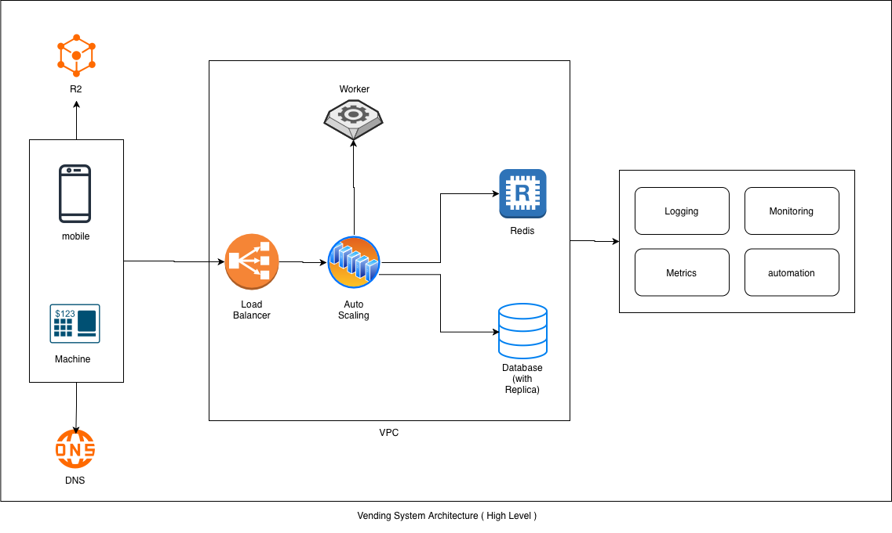

# Vending System Architecture - System Design Document

**Document Version:** 1.0  
**Last Updated:** November 12, 2025  
**Status:** Active

---

## System Architecture Diagram



_High-level vending system architecture showing client connectivity, load balancing, auto-scaling, worker processing, and observability components within a VPC._

---

## Table of Contents

1. [System Overview](#system-overview)
2. [Architecture Components](#architecture-components)
3. [Data Flow](#data-flow)
4. [Infrastructure](#infrastructure)
5. [Observability & Operations](#observability--operations)

---

## Executive Summary

The Vending System is a distributed cloud architecture with:

- Mobile and machine clients
- DNS-based routing via ONS
- Load balancing via Kekoa
- Auto-scaling via StackQL
- Redis caching layer
- Replicated PostgreSQL database
- Worker processes for background jobs
- Comprehensive observability with logging, monitoring, metrics, and automation

---

## System Overview

The architecture consists of interconnected layers within a VPC:

1. **Client Layer**: Mobile and machine endpoints
2. **Network Layer**: DNS routing (ONS) and load balancing (Kekoa)
3. **Compute Layer**: Auto-scaling (StackQL) and worker processes
4. **Data Layer**: Redis cache and replicated database
5. **Observability**: Logging, monitoring, metrics, and automation

---

## Architecture Components

### 1. Client Layer

#### 1.1 Mobile Client

- Entry point for mobile applications
- Routes requests through DNS (ONS)

#### 1.2 Machine (On-premises)

- Physical/virtual machines or web interfaces
- Routes through DNS (ONS) to cloud infrastructure

### 2. DNS & Routing Layer

#### 2.1 DNS Service (ONS)

- Domain name resolution for all client requests
- Routes clients to the load balancer

### 3. Network Layer

#### 3.1 Load Balancer (Kekoa)

- Distributes incoming traffic across backend instances
- Routes requests to Auto Scaling component

### 4. Compute Layer

#### 4.1 Auto Scaling (StackQL)

- Manages horizontal scaling of application instances based on load
- Distributes traffic to available workers

#### 4.2 Worker

- Processes asynchronous tasks and background jobs
- Handles job queue from Redis

### 5. Caching Layer

#### 5.1 Redis

- In-memory data store
- Caches frequently accessed data
- Stores job queue data

### 6. Data Layer

#### 6.1 Database (with Replica)

- Primary database for persistent data storage
- Replica for high availability and read distribution

---

## Data Flow

### Request Processing Flow

```
Client (Mobile/Machine)
    ↓
DNS (ONS) - Route request
    ↓
Load Balancer (Kekoa) - Distribute traffic
    ↓
Auto Scaling (StackQL) - Route to available instance
    ↓
Redis - Check cache
    ↓
Database (Primary/Replica) - Query/Write data
    ↓
Response returned to Client
```

### Worker Job Processing

```
Auto Scaling instance enqueues job
    ↓
Redis - Stores job in queue
    ↓
Worker - Picks up job from queue
    ↓
Worker - Processes job
    ↓
Database - Updates with results
```

---

## Infrastructure

### VPC (Virtual Private Cloud)

All compute and data resources are hosted within a VPC:

- Isolates the system infrastructure
- Hosts Load Balancer, Auto Scaling, Worker, Redis, and Database components

### R2 (External Storage)

- Cloud storage accessible from R2 interface
- Stores external resources and data

---

## Observability & Operations

The system includes observability and operational tools as shown in the architecture:

### 1. Logging

- Centralized logging for system visibility
- Tracks application and infrastructure events

### 2. Monitoring

- Real-time monitoring of system health
- Tracks performance metrics across all components

### 3. Metrics

- Collection of quantitative system data
- Enables performance analysis and alerting

### 4. Automation

- Automated responses to system events
- Supports scaling and incident management
